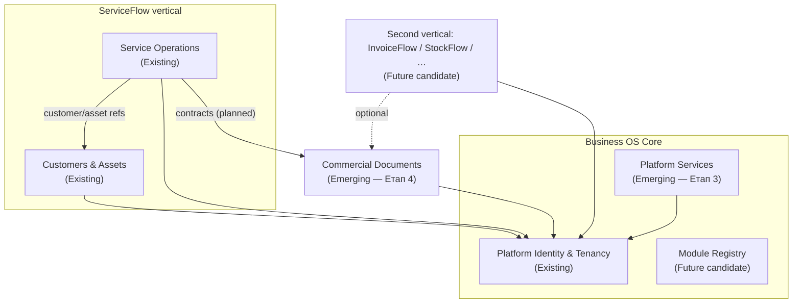

# BOS-03 — Bounded Contexts

Status: **Phase 0 discovery — proposed map, not implemented structure** ·
Date: 17.07.2026 · Each context is marked **Existing** (boundary present in code
today), **Emerging** (package or plan exists, boundary not yet enforced/built),
or **Future candidate** (no code at all).

The current codebase has *packages*, not formal contexts. This document names the
contexts those packages will roll up into. No package is moved or renamed in
Phase 0.

## 1. Context map (target modular monolith)

## 2. Context definitions

### 2.1 Platform Identity & Tenancy — **Existing**

- **Responsibility:** who the tenant is, who the user is, what session is acting,
  tenant scope construction and enforcement, technical audit.
- **Owned entities / tables:** Company (`companies`), User (`users`), AuthSession
  (`sessions`), AuditLog (`audit_log`).
- **Current location:** `serviceflow/identity/` + tenancy primitives in
  `serviceflow/shared_kernel/db.py` (TenantContext, `scoped()`, RLS binding).
- **Public contracts (today, de facto):** FastAPI dependencies in
  `identity/deps.py` (`TenantDep`, `TenantDbDep`, `require_csrf`,
  `require_owner`) and the `TenantContext` dataclass. These *are* the Core
  contract surface — formalizing them as such is roadmap Phase 2.
- **Allowed dependencies:** `shared_kernel` only.
- **Forbidden:** any vertical or shared module (must hold when Core gets its own
  package; already holds by inspection).
- **Publishes:** audit entries; login/PIN events could become domain events
  (not today — audit writes are direct).

### 2.2 Platform Services — **Emerging** (Етап 3)

- **Responsibility:** health (exists: `platform/health.py`), and per docs/13
  Етап 3: registration/onboarding, subscriptions & billing (ADR-018 provider
  port + webhook inbox), platform admin console, tenant export (ADR-012), demo
  seeding.
- **Owned tables (planned, docs/08 §platform + ADR-018):** `jobs`, subscription
  state, webhook inbox, `backup_runs`/export runs, `schema_meta`.
- **Allowed dependencies:** shared_kernel, Identity contracts.
- **Forbidden:** importing any domain module's internals. **Watch item:** tenant
  export and demo seeding need per-module data participation — that must happen
  through the module contract ([06](06_MODULE_CONTRACT.md) §export/seed hooks),
  not by platform code importing `serviceflow.customers` et al. Today's
  `seed.py` sits at top level (composition root), which is acceptable there.
- **Publishes:** subscription state changes (read-only mode gating).

### 2.3 ServiceFlow — Customers & Assets — **Existing**

- **Responsibility:** who the shop serves and what they own; GDPR anonymization;
  duplicate detection (normalized phone / transliterated name).
- **Owned tables:** `customers`, `asset_types`, `assets`, `asset_identifiers`.
- **Current location:** `serviceflow/customers/`, `serviceflow/assets/`.
- **Public contracts:** none today beyond REST; Service Operations references
  customers/assets by FK and reads models directly (same-vertical, acceptable —
  see [04](04_DEPENDENCY_RULES.md) rule R6).
- **Allowed dependencies:** shared_kernel, Identity contracts.
- **Forbidden:** platform, commercial internals.
- **Publishes:** could emit customer-anonymized event; today anonymization is a
  direct service call.

### 2.4 ServiceFlow — Service Operations — **Existing**

- **Responsibility:** the repair workflow end to end: intake, order lifecycle by
  frozen transition matrix, diagnosis/approval, part & labor lines, accessories,
  tasks, attachments, contact records, timeline, protocol PDF, warranty returns,
  search and dashboard read models.
- **Owned tables:** `service_orders`, `order_statuses` (global seed),
  `diagnoses`, `part_lines`, `labor_lines`, `accessory_items`, `tasks`,
  `attachments`, `contact_records`, `timeline_events`, and (today —
  ownership Open, see [05](05_DATA_OWNERSHIP.md)) `document_sequences`.
- **Current location:** `service_orders/`, `tasks/`, `attachments/`,
  `contacts/`, `timeline/`, `search/`, `dashboard/`.
- **Note:** these seven packages are one bounded context, not seven. The
  package-level split is healthy for code organization; the *context* boundary
  (contracts, data ownership) wraps them together. Import-linter independence
  contracts between them are therefore optional, whereas the contracts at the
  context edge are mandatory.
- **Public contracts (planned, first consumer = Commercial Documents in Етап 4):**
  read access to an order's billable lines + customer snapshot; "invoice issued /
  payment recorded" notifications inward.
- **Allowed dependencies:** shared_kernel, Identity contracts, Customers &
  Assets (same vertical), Commercial Documents *contracts* (Етап 4).
- **Forbidden:** platform internals (enforced today), commercial internals.
- **Publishes (implemented):** snake_case domain events consumed by the
  timeline subscriber — e.g. `part_added`, `labor_added`, `task_created`,
  `attachment_added`, `note_or_contact_recorded` (catalog per docs/01 §5;
  naming per code, see BOS-11 F2).

### 2.5 Commercial Documents — **Emerging** (package reserved, empty; Етап 4)

- **Responsibility:** invoices (gapless numbering, issue/annul/reissue,
  immutability BR-1), invoice lines, payments, PDF rendering of commercial docs.
- **Owned tables (planned, docs/08 §commercial):** `invoices`, `invoice_lines`,
  `payments`; takes over `document_sequences` if the Open ownership question
  resolves that way.
- **Current location:** `serviceflow/commercial/` (empty `__init__.py`).
- **Classification note:** starts life inside ServiceFlow's deployment and plan,
  but is the designated **first shared-module candidate** ([02](02_DOMAIN_CLASSIFICATION.md))
  — so it is built with context discipline from day one: it consumes Service
  Operations through an explicit read contract (billable lines, buyer data) and
  exposes its own (invoice status per order, balance).
- **Allowed dependencies:** shared_kernel, Identity contracts, Service
  Operations *contracts only*.
- **Forbidden:** importing `service_orders.models` / `.service` directly —
  this is the one place where same-vertical model sharing is **not** allowed,
  because it would erase the extraction option the PO is buying with Business OS.
- **Publishes:** invoice issued, payment recorded (timeline subscribes).

### 2.6 Module Registry / Activation — **Future candidate**

- **Responsibility:** which modules are active for which company; navigation,
  permission, i18n-namespace registration (ADR-BOS-004 model).
- **Owned tables:** none today; a `company_modules` table when a second module
  exists.
- **Exists:** no. Do not build until module #2 is committed. Defined
  conceptually in [06_MODULE_CONTRACT.md](06_MODULE_CONTRACT.md).

### 2.7 Second vertical (InvoiceFlow / StockFlow / PropertyFlow / …) — **Future candidate**

- No code, no schema, no context definition yet — deliberately. Its arrival is
  the trigger event for most Deferred items in [02](02_DOMAIN_CLASSIFICATION.md)
  and phases 5–7 of [08](08_EVOLUTION_ROADMAP.md). Defining its internals now
  would violate the governing rule (speculative abstraction).

## 3. What is deliberately *not* a context

- **`shared_kernel`** — technical primitives (ids, db base, storage port,
  normalization, event bus). It has no entities, no tables, no API. Keeping it
  primitive is a standing rule (R8 in [04](04_DEPENDENCY_RULES.md)); the
  `DomainEvent.order_id` field is the one current violation.
- **A generic "shared" business context** — explicitly avoided. Every table has
  exactly one owning context above; nothing is filed under "common".
- **Frontend** — the SPA mirrors backend modules by folder but is one delivery
  unit; per-context frontend packaging is Deferred until module activation makes
  it observable to users.
