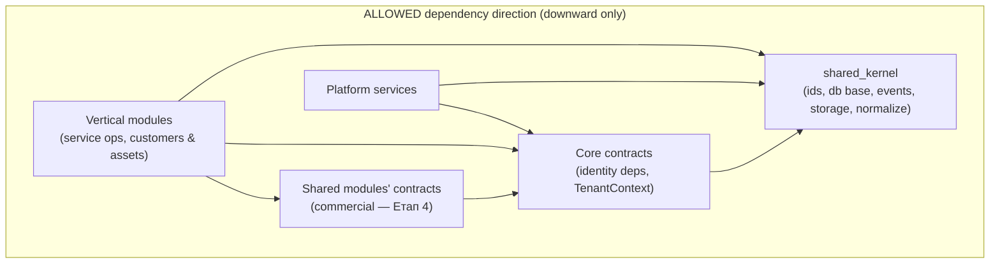
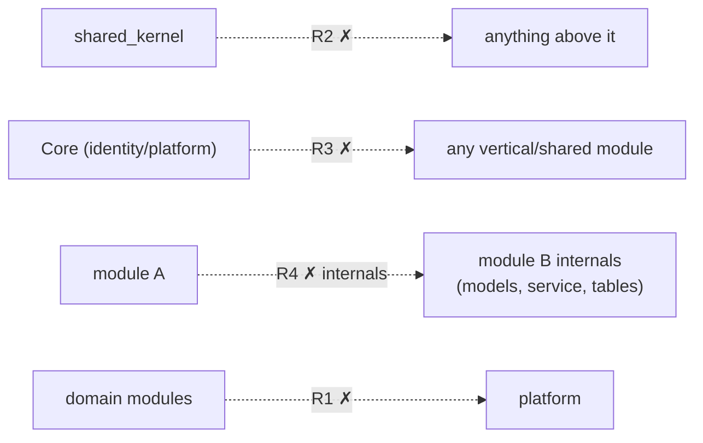

# BOS-04 — Dependency Rules

Status: **Updated 18.07.2026 (Phase 1 implemented) — R1, R2, R3, R5 are
Confirmed/enforced; R4, R6–R10 remain Recommended, enforcement gated on their
stated triggers.** Originally: Phase 0 discovery, 17.07.2026.

## 1. What is enforced today (Confirmed)

From [backend/.importlinter](../../backend/.importlinter), run in CI
(`uv run lint-imports`):

- **R1 — Domain modules must not import `serviceflow.platform`.** (ADR-001,
  docs/03 §5 dependency direction.)
- **R2 — `serviceflow.shared_kernel` imports nothing above it** (no domain, no
  platform, no config/main).
- **R3 — Business OS Core (`identity`, `platform`) must not import any
  vertical or shared module.** Added in Phase 1; see
  [12_PHASE_1_IMPLEMENTATION.md](12_PHASE_1_IMPLEMENTATION.md).

From [backend/tests/test_architecture.py](../../backend/tests/test_architecture.py),
run via `uv run pytest` (part of the existing suite, no separate command):

- **R5 — every table's mapped class lives in its declared owning package**
  (baseline check against [05_DATA_OWNERSHIP.md](05_DATA_OWNERSHIP.md) §1).
  Added in Phase 1.

Nothing else is mechanically enforced. In particular, domain modules may
currently import each other freely (and do: search/dashboard/timeline read other
modules; tasks/attachments/contacts FK-reference orders) — this is legal under
rule R6.

## 2. Target rule set (Recommended)

Forbidden (each one testable):

| # | Rule | Rationale / evidence | Enforcement mechanism |
|---|---|---|---|
| R1 | Domain modules never import platform | Confirmed — exists | **Enforced** — existing import-linter contract |
| R2 | shared_kernel imports nothing above it | Confirmed — exists | **Enforced** — existing import-linter contract |
| R3 | **Core never imports a vertical or shared module.** Core = identity, platform, shared_kernel (and any future `business_os.*` package) | The definitional Business OS rule; held by inspection before enforcement, zero violations found | **Enforced (Phase 1)** — `backend/.importlinter` contract `core-not-modules`: sources identity, platform → forbidden: customers, assets, service_orders, commercial, tasks, attachments, contacts, timeline, search, dashboard. See [12](12_PHASE_1_IMPLEMENTATION.md). |
| R4 | **A module may import another module's `contracts` subpackage only, never models/service/router.** First binding pair: commercial ↔ service_orders (Етап 4) | Preserves extraction option (ADR-BOS-003); commercial is greenfield so this costs nothing | Not yet — import-linter `layers`/`forbidden` contracts once `contracts.py` files exist (roadmap Phase 4) |
| R5 | **No module touches another module's tables** — no raw SQL against, no ORM mapping of, a table it doesn't own | Data-ownership twin of R4 ([05](05_DATA_OWNERSHIP.md)); FKs *to* another module's PK are allowed within a vertical, discouraged across contexts | **Enforced (Phase 1, baseline check)** — `backend/tests/test_architecture.py` walks `Base.registry.mappers` asserting each table's class lives in its declared owning package. See [12](12_PHASE_1_IMPLEMENTATION.md). |
| R6 | **Within one bounded context, packages may share models.** Service Operations' seven packages (orders, tasks, attachments, contacts, timeline, search, dashboard) and Customers & Assets are one vertical — direct reads stay legal there | Pragmatism directive: don't erect internal bureaucracy inside ServiceFlow | scope R4/R5 contracts to *context edges* only |
| R7 | **Cross-module reads at a context edge go through declared query contracts** (a typed function in `<module>/contracts.py`), cross-module writes through application services or domain events — never direct | The search/dashboard direct-read pattern must not cross into commercial or module #2 | same tooling as R4 |
| R8 | **shared_kernel stays domain-neutral** — no vertical vocabulary (no order, customer, invoice identifiers) | Current violation: `DomainEvent.order_id` ([events.py](../../backend/src/serviceflow/shared_kernel/events.py)); fix rides the next natural touch of the events code (Етап 3 second subscriber or Етап 4 commercial — review BOS-11 F4) | grep-based lint (forbidden identifiers in `shared_kernel/`) or review checklist; hard to fully automate — accept a checklist rule |
| R9 | **Frontend feature folders may import `lib/`, `components/`, `i18n/`, `generated/` — never each other's internals** | Mirrors backend; no enforcement exists today | ESLint `import/no-restricted-paths` zones (roadmap Phase 2, small config) |
| R10 | **A DB transaction spanning two modules' tables requires an explicit justification comment citing an ADR/BR** | Cross-module invariants are where monoliths silently fuse. Existing legitimate case: order + timeline in one transaction (ADR-011 — history must not diverge from state) — that is *the* documented exemplar | review rule; optionally a pytest fixture flagging multi-module flushes (build only if violations actually occur) |

## 3. Events

- Publishing: any module may publish domain events via `shared_kernel.events`;
  payloads must use ids + primitives, not model instances (holds today —
  `data: dict`).
- Subscribing: any module may subscribe; subscribers write within the caller's
  transaction (ADR-011). A subscriber must not import the publisher's models —
  event payload is the contract. **Current status:** timeline subscribes to
  order events; payload discipline holds; the envelope's `order_id` field is the
  R8 fix.

## 4. What is deliberately *not* a rule

- No rule against FKs from ServiceFlow tables to `companies`/`users` — Core ids
  are the platform's public identifiers (ADR-BOS-003).
- No ban on the composition root (`main.py`, `seed.py`, alembic `env.py`)
  importing everything — that is its job.
- No independence contracts *between* Service Operations' internal packages
  (R6). The `.importlinter` comment "finer independence contracts tighten in
  Stage 1" should be read with this scoping: tighten at context edges, not
  between every package.

## 5. Recommended enforcement sequencing

1. **Roadmap Phase 1 (docs-only + lint):** add R3 as an import-linter contract —
   it passes today, so it is a pure ratchet — plus the R5 baseline metadata
   test. Zero production-code changes.
2. **Phase 2:** R9 ESLint zones; Core contract v1 docstrings. (The R8 events-
   envelope fix is trigger-scheduled, not phase-scheduled — review BOS-11 F4.)
3. **Étап 4 (commercial build):** R4/R7 contracts become real with their first
   consumer; add the import-linter contracts in the same PR that creates
   `commercial/`'s first real code.

No enforcement is added in Phase 0 (this documentation phase).
