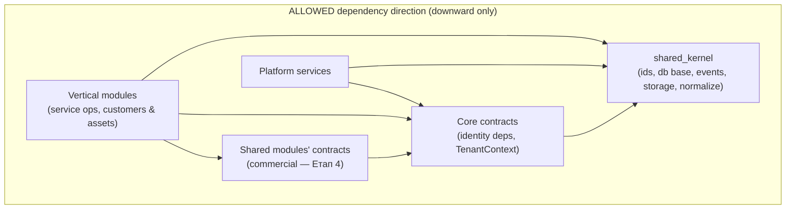
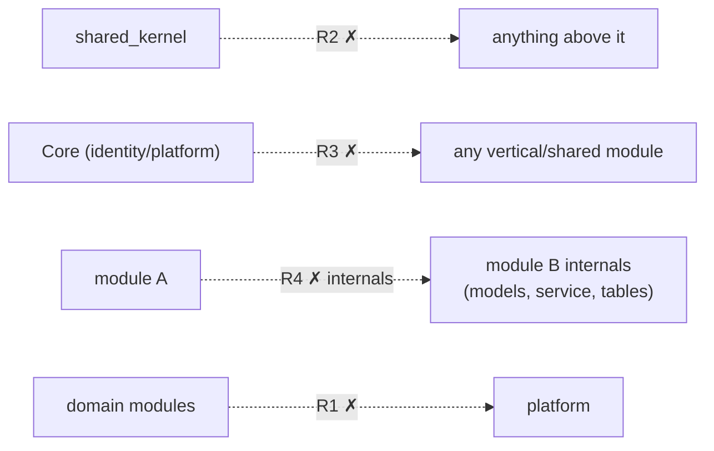

# BOS-04 — Dependency Rules

Status: **Updated 20.07.2026 (Invoice decision checkpoint's architecture
boundary repair) — R1, R2, R3, R4, R5, R9 (revised form), R11 are
Confirmed/enforced; R6–R8, R10 remain Recommended, enforcement gated on their
stated triggers.** Previously updated 18.07.2026 (Phase 2.5, see
[08](08_EVOLUTION_ROADMAP.md) naming note). Originally: Phase 0 discovery,
17.07.2026.

## 1. What is enforced today (Confirmed)

From [backend/.importlinter](../../backend/.importlinter), run in CI
(`uv run lint-imports`):

- **R1 — Domain modules must not import `serviceflow.platform`.** (ADR-001,
  docs/03 §5 dependency direction.)
- **R2 — `serviceflow.shared_kernel` imports nothing above it** (no domain, no
  platform, no config/main).
- **R3 — Business OS Core (`identity`, `platform`) must not import any
  vertical or shared module.** Added in Phase 1; see
  [12_PHASE_1_IMPLEMENTATION.md](12_PHASE_1_IMPLEMENTATION.md).

From [backend/tests/test_architecture.py](../../backend/tests/test_architecture.py),
run via `uv run pytest` (part of the existing suite, no separate command):

- **R5 — every table's mapped class lives in its declared owning package**
  (baseline check against [05_DATA_OWNERSHIP.md](05_DATA_OWNERSHIP.md) §1).
  Added in Phase 1.
- **R4 (its first pair) — commercial and service_orders each expose one
  `contracts.py` and import nothing else from the other.** Two
  `backend/.importlinter` `protected` contracts (`service-orders-public-boundary`,
  `commercial-public-boundary`), same shape as R11's `identity-public-boundary`.
  The `paid_amount`/`balance` read (service_orders needs data commercial owns)
  is *not* a second contracts-to-contracts edge — that would still be a cycle
  in spirit even if import-linter permitted it both ways. Instead
  service_orders declares a `PaymentSummaryProvider` port in its own
  `contracts.py`; commercial implements it in its `contracts.py`; the
  composition root (`serviceflow/main.py`) registers the implementation at
  import time — the same register-then-dispatch shape
  `shared_kernel.events.subscribe` already uses for the timeline subscriber.
  service_orders ends up with zero dependency on commercial in either
  direction (verified: `grimp` upstream-module check, backend/tests/
  test_architecture.py `test_no_commercial_service_orders_import_cycle`).
  Added at the Invoice decision checkpoint's architecture boundary repair,
  20.07.2026 — ahead of Invoice itself, which was not implemented in that
  change.

Nothing else is mechanically enforced. In particular, domain modules may
currently import each other freely (and do: search/dashboard/timeline read other
modules; tasks/attachments/contacts FK-reference orders) — this is legal under
rule R6.

## 2. Target rule set (Recommended)

Forbidden (each one testable):

| # | Rule | Rationale / evidence | Enforcement mechanism |
|---|---|---|---|
| R1 | Domain modules never import platform | Confirmed — exists | **Enforced** — existing import-linter contract |
| R2 | shared_kernel imports nothing above it | Confirmed — exists | **Enforced** — existing import-linter contract |
| R3 | **Core never imports a vertical or shared module.** Core = identity, platform, shared_kernel (and any future `business_os.*` package) | The definitional Business OS rule; held by inspection before enforcement, zero violations found | **Enforced (Phase 1)** — `backend/.importlinter` contract `core-not-modules`: sources identity, platform → forbidden: customers, assets, service_orders, commercial, tasks, attachments, contacts, timeline, search, dashboard. See [12](12_PHASE_1_IMPLEMENTATION.md). |
| R4 | **A module may import another module's `contracts` subpackage only, never models/service/router.** First binding pair: commercial ↔ service_orders | Preserves extraction option (ADR-BOS-003); closes the cross-import debt the Payment slice incurred (BOS-09 risk R-3 materialized exactly as predicted, then was fixed rather than compounded by Invoice) | **Enforced (Invoice decision checkpoint's architecture boundary repair, 20.07.2026)** — two `backend/.importlinter` `protected` contracts (`service-orders-public-boundary`, `commercial-public-boundary`), same `type = protected` shape R11 already proved for identity. The one asymmetric need (service_orders reading commercial-owned paid_amount/balance) is solved by inversion — a port service_orders owns, commercial implements, the composition root wires — not a second contracts-to-contracts edge. See `backend/tests/test_architecture.py`'s commercial/service_orders boundary tests. |
| R5 | **No module touches another module's tables** — no raw SQL against, no ORM mapping of, a table it doesn't own | Data-ownership twin of R4 ([05](05_DATA_OWNERSHIP.md)); FKs *to* another module's PK are allowed within a vertical, discouraged across contexts | **Enforced (Phase 1, baseline check)** — `backend/tests/test_architecture.py` walks `Base.registry.mappers` asserting each table's class lives in its declared owning package. See [12](12_PHASE_1_IMPLEMENTATION.md). |
| R6 | **Within one bounded context, packages may share models.** Service Operations' seven packages (orders, tasks, attachments, contacts, timeline, search, dashboard) and Customers & Assets are one vertical — direct reads stay legal there | Pragmatism directive: don't erect internal bureaucracy inside ServiceFlow | scope R4/R5 contracts to *context edges* only |
| R7 | **Cross-module reads at a context edge go through declared query contracts** (a typed function in `<module>/contracts.py`), cross-module writes through application services or domain events — never direct | The search/dashboard direct-read pattern must not cross into commercial or module #2 | same tooling as R4 |
| R8 | **shared_kernel stays domain-neutral** — no vertical vocabulary (no order, customer, invoice identifiers) | Current violation: `DomainEvent.order_id` ([events.py](../../backend/src/serviceflow/shared_kernel/events.py)); fix rides the next natural touch of the events code (Етап 3 second subscriber or Етап 4 commercial — review BOS-11 F4) | grep-based lint (forbidden identifiers in `shared_kernel/`) or review checklist; hard to fully automate — accept a checklist rule |
| R9 | **Revised in Phase 2 (docs/business-os/14) — the "feature folders never import each other" half was found false on inspection (9 real cross-imports: customers/order/orders/shell legitimately share components) and was not enforced.** What *is* enforced: `lib/`, `components/`, `i18n/`, `generated/` never import from a feature folder (`auth`, `customers`, `dashboard`, `intake`, `order`, `orders`, `shell`) — the frontend's real analogue to R2 | Checked before enforcing, per the same ratchet discipline as R3/R5; enforcing the original wording would have required either breaking the build or an allowlist covering most of the app | **Enforced (Phase 2)** — `frontend/src/architecture.test.ts`, runs via existing `npm test`. See [14](14_PHASE_2_IMPLEMENTATION.md). |
| R10 | **A DB transaction spanning two modules' tables requires an explicit justification comment citing an ADR/BR** | Cross-module invariants are where monoliths silently fuse. Existing legitimate case: order + timeline in one transaction (ADR-011 — history must not diverge from state) — that is *the* documented exemplar | review rule; optionally a pytest fixture flagging multi-module flushes (build only if violations actually occur) |
| R11 | **External modules may import `identity.deps`/`identity.contracts` only — never `identity.models`/`.service`/`.security`/`.router` directly.** The R4 pattern (§ above), implemented early for Identity specifically because it already has 8 real router consumers (docs/02 §3) | One real violation found and migrated (`service_orders/router.py` → new `identity.contracts.get_company_profile`); zero violations remain, enforced directly, no baseline | **Enforced (Phase 2.5 — see naming note in [08](08_EVOLUTION_ROADMAP.md))** — `backend/.importlinter` contract `identity-public-boundary`, `type = protected` (checks direct imports only — a `forbidden` contract would false-positive on every router via `identity.deps`'s own internals). See [16](16_PHASE_3_IDENTITY_BOUNDARY.md). |

## 3. Events

- Publishing: any module may publish domain events via `shared_kernel.events`;
  payloads must use ids + primitives, not model instances (holds today —
  `data: dict`).
- Subscribing: any module may subscribe; subscribers write within the caller's
  transaction (ADR-011). A subscriber must not import the publisher's models —
  event payload is the contract. **Current status:** timeline subscribes to
  order events; payload discipline holds; the envelope's `order_id` field is the
  R8 fix.

## 4. What is deliberately *not* a rule

- No rule against FKs from ServiceFlow tables to `companies`/`users` — Core ids
  are the platform's public identifiers (ADR-BOS-003).
- No ban on the composition root (`main.py`, `seed.py`, alembic `env.py`)
  importing everything — that is its job.
- No independence contracts *between* Service Operations' internal packages
  (R6). The `.importlinter` comment "finer independence contracts tighten in
  Stage 1" should be read with this scoping: tighten at context edges, not
  between every package.

## 5. Recommended enforcement sequencing

1. **Roadmap Phase 1 (docs-only + lint) ✅:** add R3 as an import-linter
   contract — it passes today, so it is a pure ratchet — plus the R5 baseline
   metadata test. Zero production-code changes. See [12](12_PHASE_1_IMPLEMENTATION.md)
   and the follow-up audit [13](13_PHASE_1_VERIFICATION_AUDIT.md).
2. **Phase 2 ✅:** R9, revised to the boundary that actually holds (leaf
   directories never import a feature folder — see [14](14_PHASE_2_IMPLEMENTATION.md));
   Core contract v1 docstrings. (The R8 events-envelope fix is
   trigger-scheduled, not phase-scheduled — review BOS-11 F4.)
3. **Phase 2.5 ✅:** R11 — Identity's public contract mechanically enforced
   (`type = protected`), one real violation migrated, zero baseline needed.
   See [16](16_PHASE_3_IDENTITY_BOUNDARY.md) and the naming note in
   [08](08_EVOLUTION_ROADMAP.md).
4. **Étап 4 (commercial build) — R4 ✅ (20.07.2026), R7 still Recommended:**
   commercial's first real code (the Payment slice) shipped *without* the R4
   contracts — exactly the BOS-09 risk R-3 scenario ("commercial built with
   direct model imports because contracts feel ceremonial"). The Invoice
   decision checkpoint caught it before Invoice compounded the debt; the
   architecture boundary repair added the import-linter contracts and
   retrofitted the Payment slice's direct imports to the contract/port shape
   described above, one slice later than the original plan called for, not
   in the same PR. R7 (the general "cross-module reads through
   `contracts.py`" pattern, beyond this one edge) remains Recommended.

No enforcement is added in Phase 0 (this documentation phase).
