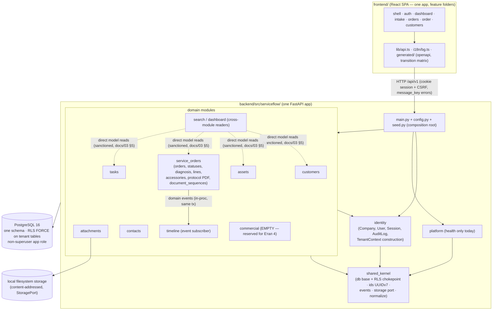
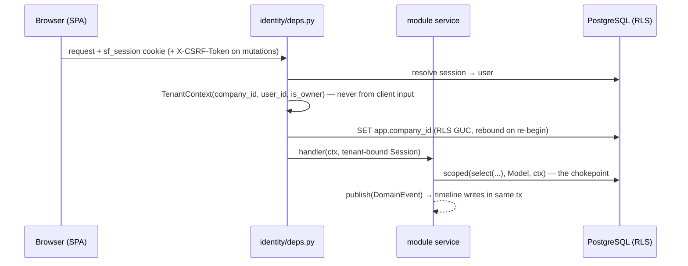

# Diagram — Current Architecture (as implemented, commit `6c324ff`)

Everything on this page exists in code today. See
[01_REPOSITORY_ASSESSMENT.md](../01_REPOSITORY_ASSESSMENT.md) for the prose.

## Backend packages and real import direction

Enforced today (`backend/.importlinter`, CI): domain ↛ platform;
shared_kernel imports nothing above it. Not yet enforced: anything else.

## Request path (tenant scoping)

## Known coupling points (facts, listed in 01 §8)

- `shared_kernel.events.DomainEvent.order_id` — vertical concept in bottom layer
- `timeline_events.order_id` NOT NULL → timeline is order history
- tasks/attachments/contact_records FK → `service_orders.id`
- `document_sequences` defined in service_orders, filed under commercial in docs/08
- search/dashboard read other modules' models directly
