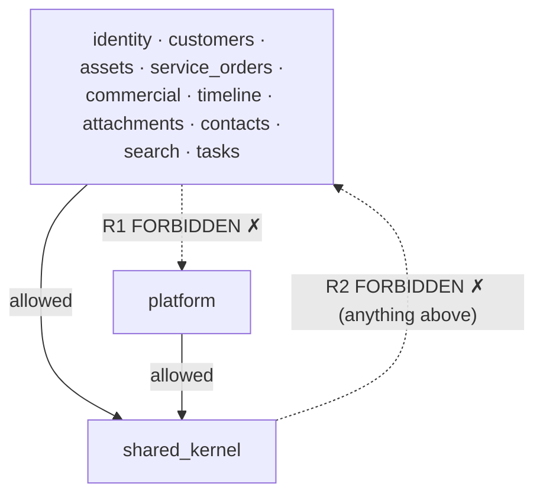
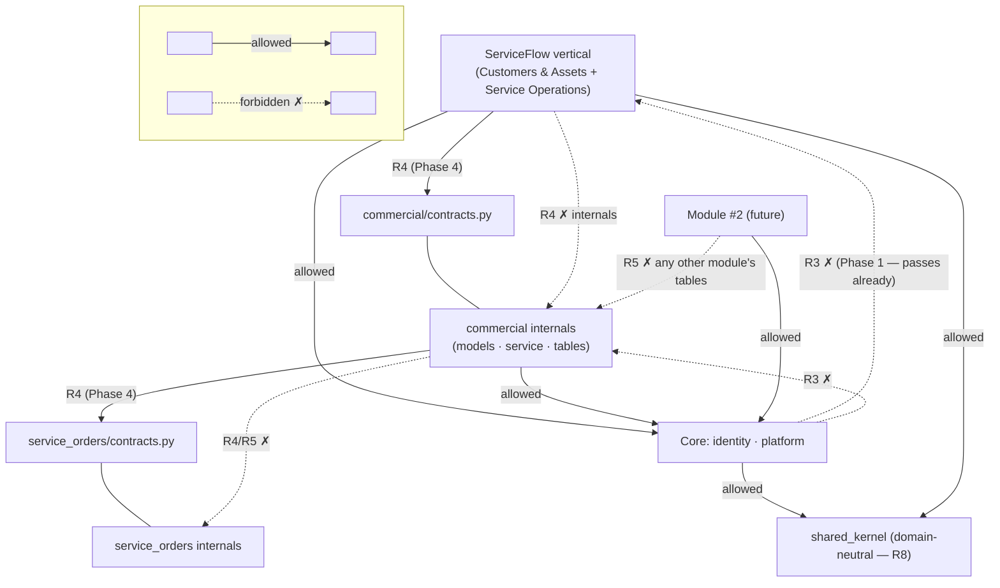

# Diagram — Dependency Map (rules view)

Companion to [04_DEPENDENCY_RULES.md](../04_DEPENDENCY_RULES.md). Left: what CI
enforces today. Right: the target ratchet. Rule numbers R1–R10 are defined in 04.

## Enforced today (backend/.importlinter — Confirmed)

## Target ratchet (Recommended; phase = when the rule becomes CI-enforced)

## Rule → mechanism → phase summary

| Rule | Mechanism | Enforced from |
|---|---|---|
| R1 domain ↛ platform | import-linter (exists) | today |
| R2 shared_kernel bottom | import-linter (exists) | today |
| R3 Core ↛ modules | import-linter contract `core-not-modules` | **Phase 1 ✅ (18.07.2026)** |
| R4 contracts-only across context edges | import-linter, added with first `contracts.py` | Phase 4 (Етап 4) |
| R5 one writer per table | pytest over `Base.registry.mappers` (`backend/tests/test_architecture.py`) | **Phase 1 ✅ (18.07.2026, baseline)** |
| R6 free imports inside a context | scoping of R4/R5 (no rule needed) | — |
| R7 cross-context reads via query contracts | same as R4 | Phase 4 |
| R8 shared_kernel domain-neutral | review checklist (the one known violation is fixed at the next natural touch of events code — BOS-11 F4) | trigger-scheduled, not this phase |
| R9 frontend: leaf dirs ↛ feature folders (revised — see BOS-14) | `vitest` + `import.meta.glob` (`frontend/src/architecture.test.ts`) — no ESLint installed | **Phase 2 ✅ (18.07.2026)** |
| R10 cross-module transactions justified | review rule; ADR-011 timeline is the documented exemplar | today (convention) |
