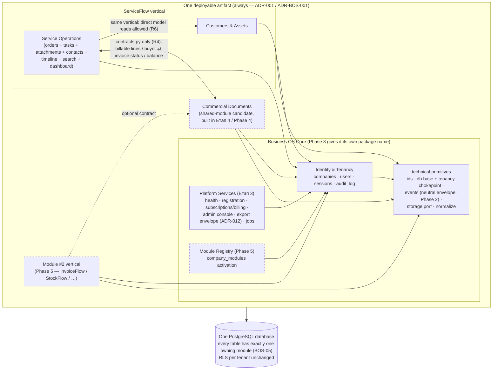

# Diagram — Target Modular Monolith (proposed, NOT implemented)

Everything on this page is **proposed future architecture** ([03](../03_BOUNDED_CONTEXTS.md),
[08](../08_EVOLUTION_ROADMAP.md)). It remains one deployable application at every
stage. Phase numbers refer to the roadmap.

Key properties (all Recommended):

1. **Core never points up.** No arrow leaves CORE toward a module (rule R3 —
   lintable from Phase 1).
2. **Context edges are contract-only.** The single double-arrow
   (Service Operations ⇄ Commercial) is the first real one; module #2 gets the
   same treatment. Inside a vertical, packages stay informal (R6).
3. **Events flow through the neutral bus** in shared_kernel; payloads are ids +
   primitives; subscribers never import publisher models.
4. **Module Registry is data, not a loader** — dashed because it does not exist
   and is not built before module #2 (ADR-BOS-004).
5. **The database does not split.** Ownership is logical (matrix in BOS-05),
   enforced by lint/test — not by schemas, roles, or separate databases in v1.
