# PS-09 — Domain Model

Status: **Draft for PO review** · Date: 18.07.2026 · Module: `professional-services`

The conceptual model. Persistence mapping is in [25_DATA_MODEL.md](25_DATA_MODEL.md);
behavioural rules in [26_BUSINESS_RULES.md](26_BUSINESS_RULES.md). Terms per
[04_GLOSSARY_AND_TERMINOLOGY.md](04_GLOSSARY_AND_TERMINOLOGY.md).

## 1. Model overview

```mermaid
classDiagram
    class Client { kind: person|org; name; eik?; phones; emails; address?; notes }
    class ClientContact { name; role?; phone?; email? }
    class ServiceType { name; active; sort; defaults→ }
    class WorkflowTemplate { name; active }
    class TemplateStage { name; category; sort }
    class ChecklistTemplate { name; items[] }
    class Assignment {
      number; title; description; priority
      lifecycle_state; org_label*
      received_on; planned_start_on
      internal_target_on; official_deadline_on(+time?)
      completed_at; cancelled_reason?
      agreed_price?; currency
      details: typed JSONB per service type
      last_activity_at (derived)
    }
    class AssignmentStage { name; category; sort; is_current }
    class NextAction { description; due_on; reminder_on?; blocking_reason?; is_appointment; status }
    class Task { title; kind: task|checklist; due_on?; done_at?; sort }
    class DocumentRequirement { name; status: missing|requested|received|waived }
    class DossierFile { category; filename; storage_key; uploaded_at }
    class CommunicationEntry { type; direction; occurred_at; note }
    class PaymentEntry { kind; amount; on_date; note }
    class DeadlineChange { field; old; new; reason; changed_at }
    class ActivityEvent { type; payload; actor; at (append-only) }
    class AssignmentLink { relation; target }

    Client "1" --> "*" Assignment
    Client "1" --> "*" ClientContact
    Assignment --> "0..1" ClientContact : contact person
    ServiceType "1" --> "*" Assignment
    ServiceType --> "0..1" WorkflowTemplate : default
    ServiceType --> "0..1" ChecklistTemplate : default
    WorkflowTemplate "1" --> "*" TemplateStage
    Assignment "1" --> "*" AssignmentStage : own copy
    Assignment --> "*" NextAction : history, ≤1 open
    Assignment --> "*" Task
    Assignment --> "*" DocumentRequirement
    Assignment --> "*" DossierFile
    Assignment --> "*" CommunicationEntry
    Assignment --> "*" PaymentEntry
    Assignment --> "*" DeadlineChange
    Assignment --> "*" ActivityEvent
    Assignment --> "*" AssignmentLink : follow-up / cs-project
```

Users are **Core entities** (identity module); this module references
`user_id` (owner, assignee, actor) and stores a module role per user — it
never owns user records.

## 2. The aggregate

**Assignment is the single aggregate root.** Everything a firm would put in
the paper file — actions, tasks, requirements, files, communications, money
entries, deadline changes, activity — is a child reachable only through it.
Consequences:

- child records carry `assignment_id` (NOT NULL) + `company_id`; no child is
  shared between assignments (a file needed twice is uploaded/linked twice —
  acceptable at this scale, keeps deletion/export/RLS trivial);
- invariants that span children (≤1 open next action; stage validity;
  derived money totals) are enforced in the aggregate's service layer inside
  one transaction — no cross-aggregate sagas exist;
- `Client`, `ServiceType`, `WorkflowTemplate`, `ChecklistTemplate` are
  separate small aggregates (org-scoped reference data) referenced by id.

## 3. Key modelling decisions (with reasoning)

### 3.1 Stage copies, not template references (ADR-PS-005)

At creation the template's stages are **copied** onto the assignment
(`AssignmentStage` rows). The assignment then owns its stage list; template
edits never mutate in-flight work; deleting/renaming a template is safe.
Cost: a few extra rows per assignment — trivial. This is the same
"snapshot over live reference" instinct as ServiceFlow's frozen matrix,
adapted to configurability.

### 3.2 One open next action, with history

`NextAction` is its own entity (not fields on Assignment) because it has a
lifecycle (open → done/cancelled/superseded), history value ("what did we do
last month on this?"), and an owner distinct from the assignment owner. A
partial unique index enforces ≤1 open per assignment ([14](14_NEXT_ACTION_MODEL.md)).

### 3.3 Dates are distinct, typed fields

Seven date concepts, seven homes — assignment columns (received, planned
start, internal target, official deadline, completed), next-action due,
task due, requirement dates, payment due, reminder dates. There is **no
generic `deadline` field or polymorphic dates table** in MVP: a
`ps_deadlines` super-table was considered and rejected — it makes every
query join-heavy and every rule conditional, for zero present benefit. The
deadline *engine* reads the typed fields directly ([13](13_DEADLINE_AND_REMINDER_ENGINE.md)).

### 3.4 Typed JSONB `details` per service-type kind

Court-expertise needs court/case №/questions/deposit; valuation needs
property/purpose; acts need project/investor. These go into
`Assignment.details` (JSONB) with a **code-owned schema per detail kind**
(draft JSON Schemas in [../schemas/assignments/](../schemas/assignments/)),
validated at the API boundary — the platform's standing typed-JSONB pattern
(docs/08 §4), explicitly not EAV, not custom fields.

### 3.5 Derived, never stored: risk and money totals

`risk_state`, `staleness`, `invoiced/paid/outstanding`, `last_activity_at`
are computed (SQL views/expressions over indexed columns). Nothing the
engine derives is user-editable; nothing user-editable is derived. This is
what makes warnings reproducible (invariant INV-9, [26](26_BUSINESS_RULES.md)).

### 3.6 What is deliberately absent

- **No Milestone entity** — delivery-category stages serve the purpose.
- **No task dependencies** — ordered checklist suffices ([15](15_TASKS_AND_CHECKLISTS.md)).
- **No Property/Court/Project entities** — they live inside `details`;
  promoting them to tables is a future step if cross-assignment reuse is
  proven (e.g. same property valued yearly) — recorded in [36](36_RISKS_AND_OPEN_QUESTIONS.md) §Q-5.
- **No shared Party with ServiceFlow** — ADR-PS-003.
- **No WorkflowInstance entity** — the assignment's stage copy *is* the
  instance; a separate instance object adds nothing at one-workflow-per-
  assignment.

## 4. How one model carries the three examples

| Concept | Court expertise | Valuation | Construction acts |
|---|---|---|---|
| Client | court (org) — sometimes plus paying party as payment note | bank / individual | investor / builder |
| details (typed) | court name, case №/year, questions, deposit amount+status | property address, type, cadastral id, purpose | project name, site, permit ref, acts list |
| Official deadline | submission term | bank SLA date | contractual delivery |
| Appointment | hearing (next action, `is_appointment`) | inspection | act-signing meeting |
| Document requirements | case materials, deposit proof | нот. акт, скица, данъчна оценка | design docs per part |
| Checklist | expertise checklist ([../examples/court-expertise/](../examples/court-expertise/)) | valuation checklist | acts checklist |
| Delivery | submitted to court | report handed to bank | signed acts delivered |
| Follow-up link | допълнителна експертиза | updated valuation | next acts batch |

Full worked instances (JSON + narrative) live in [../examples/](../examples/).

## 5. Domain events (published on the shared bus)

Snake_case, module-namespaced, payloads = ids + primitives (platform
convention, BOS-06; naming now platform-mandated by ADR-BOS-007 — this
catalogue was designed to that shape from the start, so it needs no
rework): `ps_assignment_created`, `ps_stage_changed`, `ps_lifecycle_changed`,
`ps_next_action_set`, `ps_next_action_completed`, `ps_task_completed`,
`ps_document_received`, `ps_file_added`, `ps_communication_logged`,
`ps_deadline_changed`, `ps_payment_recorded`. MVP's only subscriber is the
module's own activity-event writer. Once published, per ADR-BOS-007 §3
these names are a stable contract — adding new types is free; renaming or
removing one follows the docs/07-style change process. The catalogue
exists so future consumers (global search indexing per ADR-BOS-006,
cross-module feed, future AI consumers) attach without schema change.
