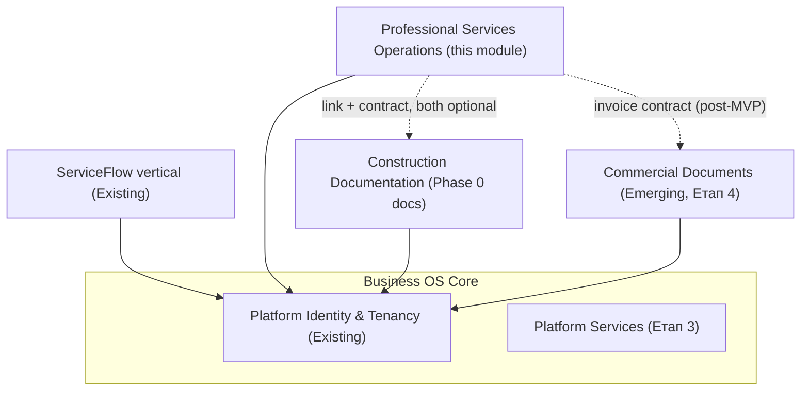

# PS-10 — Bounded Contexts

Status: **Draft for PO review** · Date: 18.07.2026 · Module: `professional-services`

Extends the platform context map (BOS-03) with this module. Follows the
platform precedent that one bounded context may span several code packages
(BOS-03 §2.4 note on Service Operations).

## 1. This module = one bounded context

**Professional Services Operations** — a single context owning the whole
vertical: assignments, workflow templates, next actions, deadline engine,
tasks/checklists, clients, dossier, communications, payments-on-assignment,
notifications, activity history.

Considered and rejected: splitting "Clients", "Deadline Engine", or
"Notifications" into their own contexts. Each would create contract ceremony
between parts that share one team, one language, and one transaction scope —
exactly the premature-boundary mistake BOS-00 warns against. They are
**internal packages**, not contexts:

```
professional_services/
├── clients/          # Client, ClientContact
├── catalog/          # ServiceType, WorkflowTemplate, ChecklistTemplate
├── assignments/      # aggregate root + stages + lifecycle + details
├── actions/          # NextAction
├── tasks/            # Task
├── dossier/          # DossierFile, DocumentRequirement
├── communications/   # CommunicationEntry
├── billing_light/    # PaymentEntry (name avoids "commercial" collision)
├── alerts/           # deadline/staleness engine + Notification
├── activity/         # ActivityEvent writer/reader (bus subscriber)
└── contracts.py      # the context's public surface (initially near-empty)
```

Intra-module package imports are free (same context); the *context edge* is
what import-linter guards.

## 2. Context relationships



| Relationship | Kind | Notes |
|---|---|---|
| PSO → Core Identity & Tenancy | **Conformist** (upstream fixed) | consumes `identity.deps`/`identity.contracts` + `shared_kernel` primitives exactly as published (BOS-16); requests nothing bespoke |
| PSO → Platform Services | Conformist | health hook, export section, activation flag — per module contract BOS-06 |
| PSO ↔ ServiceFlow | **Separate Ways** | no relationship at all: no shared tables, no contracts, no imports either direction. The only sharing is Core and *patterns* ([27](27_SERVICEFLOW_REUSE_AUDIT.md)) |
| PSO ↔ Construction Documentation | **Partnership via ACL-thin link** | opaque link + small read contract each way; neither imports the other's models ([29](29_CONSTRUCTION_DOCUMENTATION_INTEGRATION.md)) |
| PSO → Commercial Documents | Customer/Supplier (future) | PSO will consume invoicing via contract when Етап 4 ships; MVP has its own minimal payment entries instead ([21](21_FINANCIAL_BOUNDARIES.md)) |

## 3. Ubiquitous-language boundaries

Words change meaning at context edges; translations are explicit:

| Word | In PSO | In neighbours |
|---|---|---|
| Client | PSO's `ps_clients` row | ServiceFlow's Customer is a **different entity** — never reconciled in v1 |
| Task | child of an Assignment | ServiceFlow `tasks` is a different table with repair semantics (`is_call`) |
| Project | informal label an org may choose for Assignment | in CS, Project is the knowledge-base aggregate — the CS meaning wins in integration docs; PSO docs say "CS project" |
| Deadline | typed PSO date fields | CS has document/act dates of its own; never merged |
| Invoice | a recorded fact (amount, note) in MVP | a real document in Commercial Documents — on integration, PSO's record becomes a reference to theirs |

## 4. Data & event ownership at the edge

- Every `ps_*` table is owned (exclusive write) by this context — extends
  the BOS-05 ownership matrix in the same PR that creates the tables.
- PSO publishes `ps_*` events (catalogue in [09 §5]); consumes **no** other
  module's events in MVP. CS-integration events are Proposed in [29] and
  activate only when both modules exist in code.
- PSO reads Core tables only through Core's published dependencies —
  never SQL against `users`/`companies` directly beyond what the scoped
  session exposes today (platform rule).

## 5. Fitness rules (enforceable once code exists)

1. import-linter: `professional_services` may import only `shared_kernel`,
   `identity.deps`, `identity.contracts` (and stdlib/3rd-party).
2. import-linter: nothing outside `professional_services` imports anything
   from it except `professional_services.contracts`.
3. Architecture test (pattern from Phase-1 `test_architecture.py`): every
   mapper for a `ps_*` table lives inside the module; no other module maps
   `ps_*` tables.
4. Composition root (`main.py` router registration, seed hooks) is the only
   place PSO and other modules co-appear.
