# PS-11 — Assignment Lifecycle

Status: **Draft for PO review** · Date: 18.07.2026 · Module: `professional-services`

The **lifecycle state** is the small, fixed, code-owned state machine every
assignment moves through regardless of workflow configuration. Configurable
**stages** ([12](12_WORKFLOW_AND_STATUS_MODEL.md)) describe *where the work
is*; lifecycle states describe *what the record legally is*. Keeping the
invariant-bearing machine in code while vocabulary stays configurable is the
central design split of this module (ADR-PS-005).

## 1. States

| State | BG | Meaning | Invariants attached |
|---|---|---|---|
| `active` | Активна | accepted, work owed | must have service type + owner (or explicit unassigned flag); should have open next action (soft — surfaced, not blocked); official deadline warnings run |
| `delivered` | Предадена | output handed over; close-out pending | delivery info recorded; deadline-breach warnings stop; close-out staleness warning starts (`undelivered_closeout`) |
| `completed` | Приключена | nothing further expected | terminal; completion time + actor recorded; record read-only except payment entries and files (late invoice/receipt arrives) — each such write still audit-logged |
| `cancelled` | Отказана | will not be delivered | terminal; reason mandatory; record read-only same as completed |

There is **no `draft` state**: J-1 requires intake to be real immediately; a
half-known assignment is simply `active` with few fields. There is **no
`on_hold` state**: waiting is a *stage category* (waiting_client /
waiting_documents), because "on hold" without an owner and a follow-up date
is exactly the P5 stall this product exists to kill.

## 2. Transitions

```mermaid
stateDiagram-v2
    [*] --> active : create (J-1)
    active --> delivered : deliver (delivery info required)
    active --> cancelled : cancel (reason required)
    delivered --> active : return_for_corrections (reason required)
    delivered --> completed : complete
    active --> completed : complete_directly (consultations etc.)
    delivered --> cancelled : cancel (rare; reason required)
    completed --> [*]
    cancelled --> [*]
```

Transition rules (full matrix — anything not listed is invalid and rejected
server-side with `ps.error.invalid_transition`):

| From → To | Guard | Side effects |
|---|---|---|
| create → active | client, service type, title present | number allocated; stages copied; checklist/requirements instantiated; `ps_assignment_created` |
| active → delivered | delivery date+method entered | open next action auto-closed as superseded unless flagged keep (e.g. hearing after submission); `ps_lifecycle_changed` |
| active → completed | confirm dialog (skips delivery — legitimate for advice-type work) | completion recorded |
| delivered → active | reason required | logged as correction round; deadline warnings resume |
| delivered → completed | — | completion recorded |
| active/delivered → cancelled | reason required; manager+ role | open next action/tasks auto-closed as cancelled |

All lifecycle transitions: manager+ or the assignment owner (except cancel:
manager+ only) — matrix in [20](20_ROLES_AND_PERMISSIONS.md); every
transition writes an activity event with actor and, where present, reason.

## 3. Terminal behaviour (ADR-PS-012)

**Terminal states do not reopen.** The one sanctioned "reopen" is
`delivered → active` for corrections, which is not terminal-escape but part
of normal delivery back-and-forth. Once `completed`/`cancelled`:

- follow-on work = **new linked assignment** (`AssignmentLink`, relation
  `follow_up_of`), pre-filled from the original (client, contact, service
  type, details), fresh number, fresh deadlines, own dossier;
- consequences accepted: counts count two assignments (correct — two
  engagements); the link renders prominently on both details screens;
- mistake-made-terminal ("clicked complete by accident"): owner-role users
  may revert a terminal transition **within 24 h** of the transition; the
  revert itself is audit-logged with reason. After 24 h: follow-up
  assignment. This narrow escape hatch mirrors ServiceFlow's BR-2 unlock
  philosophy without copying its mechanics.

## 4. Deletion, archiving, retention

- **No hard delete of assignments, ever, via the application.** Cancelled ≠
  deleted; both remain queryable. (Auditors, disputes, P12.)
- **Archive is a filter, not a state:** lists default to hiding
  completed/cancelled older than a threshold (org setting, default 30 days
  after completion); "показване на архива" reveals them. No archive flag on
  the record — derived from state + completion date, zero migration burden.
- Client personal-data erasure (GDPR) anonymizes the client and strips
  person-identifying strings from assignment title/description via a guided
  review step — records and numbers survive ([16](16_CLIENT_MODEL.md) §5,
  [30](30_SECURITY_PRIVACY_AND_AUDIT.md)).
- True purge (tenant offboarding) is a platform capability (ADR-012 export
  then tenant deletion), not a module feature.

## 5. Lifecycle × engine interactions (summary; normative text in [13])

| State | Deadline warnings | Staleness | Notifications |
|---|---|---|---|
| active | official + internal streams on | on (all signals) | full set |
| delivered | off (delivery happened) | only `undelivered_closeout` | close-out reminder |
| completed / cancelled | off | off | none |
